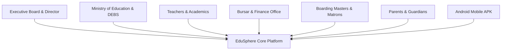

# Legacy School Solwezi — EduSphere SMIS Enterprise
## Comprehensive Stakeholder User Guide & Operational Manual
**Version:** 2.0.0 • **Academic Session:** 2026 Term 3 • **Deployment:** Sovereign Multi-Campus

---

## Table of Contents
1. [Executive Summary & Institutional Architecture](#1-executive-summary--institutional-architecture)
2. [User Personas & Role-Based Access Control (RBAC)](#2-user-personas--role-based-access-control-rbac)
3. [Core Operational Workflows](#3-core-operational-workflows)
   - [3.1 Admissions, Enrolment & Learner Records](#31-admissions-enrolment--learner-records)
   - [3.2 Official Document Generator (Letters & Certificates)](#32-official-document-generator-letters--certificates)
   - [3.3 Multi-Horizon Attendance & Roll-Call Engine](#33-multi-horizon-attendance--roll-call-engine)
   - [3.4 Academic Markbooks, ECZ Grading & Report Cards](#34-academic-markbooks-ecz-grading--report-cards)
   - [3.5 360° Boarding House Management & Safeguarding](#35-360-boarding-house-management--safeguarding)
   - [3.6 Bursary, Invoicing, Mobile Money & Double-Entry Ledger](#36-bursary-invoicing-mobile-money--double-entry-ledger)
   - [3.7 Multi-Campus GIS & Smart Transport Network](#37-multi-campus-gis--smart-transport-network)
   - [3.8 Human Resources & Teaching Council Governance](#38-human-resources--teaching-council-governance)
   - [3.9 Parent Portal & Guardian Self-Service](#39-parent-portal--guardian-self-service)
   - [3.10 Android Native Mobile App (APK) Operations](#310-android-native-mobile-app-apk-operations)
4. [Statutory Compliance & Regulatory Governance](#4-statutory-compliance--regulatory-governance)
5. [Disaster Recovery, Data Sovereignty & Offline Resilience](#5-disaster-recovery-data-sovereignty--offline-resilience)
6. [Frequently Asked Questions (FAQ) & Support Directory](#6-frequently-asked-questions-faq--support-directory)

---

## 1. Executive Summary & Institutional Architecture

**EduSphere SMIS Enterprise** is the sovereign, purpose-built School Management Information System engineered specifically for **Legacy School Solwezi**, encompassing:
- **Mushitala Day Campus** (ECE, Primary, Junior Secondary)
- **Kansanshi Boarding Campus** (Senior Secondary, ECZ National Examination Centre)

The platform unifies academic markbooks, statutory Ministry of Education returns, automated tuition invoicing with Airtel/MTN mobile money reconciliation, 360° boarding house curfew and safeguarding, multi-campus GIS routing, and native Android mobile operations into a single, high-security ecosystem.

### Key Technical Pillars
- **Zero Data Loss Guarantee**: Strict UPSERT-only data persistence with immutable audit trails.
- **Offline-First Resilience**: Classroom roll-calls and curfew checks function without cellular connectivity, automatically queuing and syncing upon reconnection.
- **Zambian Curriculum Alignment**: Built-in 8-scale ECZ secondary grading, 5-scale primary grading, and early childhood developmental milestones.
- **Sovereign Multi-Campus Scoping**: Strict data partitioning between Mushitala Day and Kansanshi Boarding facilities, with consolidated board-level oversight.

---

## 2. User Personas & Role-Based Access Control (RBAC)

EduSphere enforces strict, multi-tiered Role-Based Access Control to ensure data privacy, confidentiality, and statutory accountability:

| Role Title | Target Users | Accessible Portals | Primary Authority & Governance |
| :--- | :--- | :--- | :--- |
| **School Director / Board** | Mr. Emmanuel Mwansa & Trustees | `/`, `/admin`, `/gis` | Institutional oversight, financial viability, multi-campus expansion, board KPI reports. |
| **Headteacher / Principal** | Academic Principals & Deputies | `/`, `/academics`, `/hr` | Curriculum supervision, markbook approvals, official report card publication, teacher evaluations. |
| **Registrar / Admissions** | Enrolment Officers | `/admissions`, `/admin` | Learner onboarding, KYC verification, document issuance (Offer/Acceptance), student ID cards. |
| **Bursar / Finance Officer** | Accounts Department | `/finance` | Fee catalog, invoicing, mobile money settlements, expenditure vouchers, double-entry ledger. |
| **Class / Subject Teacher** | Faculty & Subject Heads | `/teacher`, `/attendance` | Daily morning roll-calls, continuous assessments, rubric evaluations, homework distribution. |
| **Boarding Master / Matron** | Residential Pastoral Staff | `/boarding`, Mobile APK | Night curfews, dormitory bed checks, exeat gate passes, clinic visit logging. |
| **Parent / Legal Guardian** | Registered Guardians | `/parent`, Mobile APK | Fee balance review, instant tuition payment, real-time attendance alerts, report card PDF download. |
| **DEBS / MoE Inspector** | Ministry Auditors | Read-Only Regulatory | Statutory Form 12A audits, teacher TCZ accreditation checks, attendance verification. |

---

## 3. Core Operational Workflows

### 3.1 Admissions, Enrolment & Learner Records
- **Route:** `/admissions`
- **Primary Operators:** Registrar, Admissions Officers.

#### Workflow Steps:
1. **Candidate Registration**: Click **"New Candidate Enrolment"** to record student biodata (Full Legal Name, Date of Birth, Gender, NRC/Birth Certificate number, Special Needs status).
2. **Campus & Cadre Assignment**:
   - Assign to either **Mushitala Day Campus** or **Kansanshi Boarding Campus**.
   - Designate cadre: *Full Residential Boarder* vs. *Day Scholar*.
3. **Verified Guardian Association**:
   - Link primary and secondary guardians with verified mobile numbers (+260 Zambian format).
   - This telephone number automatically grants secure access to the **Parent Portal** via OTP.
4. **Automated Account & Unique Identifier Generation**:
   - System issues a permanent Zambian MoE-compliant Student ID (e.g., `LS-2026-0042`).
   - Automatically provisions the student's tuition account in the Financial Ledger.

---

### 3.2 Official Document Generator (Letters & Certificates)
- **Routes:** Integrated across `/admissions`, `/admin`, and learner profile cards.
- **Supported Documents:**
  1. **Official Acceptance Letter** (Confirms placement for the upcoming session)
  2. **Provisional Admission Offer Letter** (Sets fee terms, requirements, and deposit deadlines)
  3. **Introduction / Visa / Passport Letter** (Addressed to Ministry, Embassies, or Banks)
  4. **ECZ Examination Clearance Certificate** (Confirms financial & academic eligibility)
  5. **Boarding Residence Confirmation** (Specifies assigned dormitory and housemaster)

#### Operating Instructions:
1. Locate the learner from the student list or admissions directory.
2. Click **"Generate Official Document"**.
3. Select the required document template from the dropdown.
4. Enter optional custom notes (e.g., specific embassy address, medical clearance clauses).
5. The system generates an enterprise-grade document featuring:
   - **Official Legacy School Crest & Header** with Solwezi campus addresses and MoE registration numbers.
   - **Student Identity Table** (Learner ID, Grade, Cadre, Guardian, Academic Session).
   - **Digital Verification QR Stamp** for anti-fraud validation.
   - **Authorized Signatory** (Director Mr. Emmanuel Mwansa or Head of Admissions).
6. Click **"Print / Download PDF"** for distribution.

---

### 3.3 Multi-Horizon Attendance & Roll-Call Engine
- **Route:** `/attendance`
- **Primary Operators:** Class Teachers, Deputy Headteachers, Attendance Monitors.

EduSphere features a **Multi-Horizon Attendance Matrix** that tracks pupil presence across five synchronised tiers:
- **Daily Horizon**: Morning roll-call with timestamped status (*Present, Late with Minutes, Excused Illness, Unexcused Absent*).
- **Weekly Horizon**: Progression across Weeks 1 to 13 of Term 3.
- **Monthly Horizon**: 12-Month academic register covering all statutory instructional days.
- **Termly Horizon**: Ministry Terms 1, 2, and 3 aggregate rates.
- **Annual Horizon**: 187-Day statutory cumulative tracker for national progression and ECZ clearance.

#### Operating Instructions:
1. Select your assigned **Classroom** (e.g., *Grade 10A Science* or *Grade 1 Blue*).
2. The current date defaults to the live instructional session (**Monday, 19 October 2026 • Term 3 Week 8**).
3. Tap **"Mark All Present"** for rapid 1-tap roll-call, then selectively toggle any absent or late pupils.
4. Enter excuse codes for medical or domestic absences.
5. Click **"Commit Session Register"**. The system instantly updates:
   - The student's annual attendance percentage.
   - The chronic absenteeism risk scorecard.
   - SMS alert dispatch to the registered guardian for unexcused absences.

---

### 3.4 Academic Markbooks, ECZ Grading & Report Cards
- **Route:** `/academics` & `/teacher`
- **Primary Operators:** Subject Teachers, Heads of Department, Headteacher.

#### Grading Standards Built-In:
- **ECZ Secondary Scale (Grades 8–12)**:
  - `Distinction (1)`: 75% – 100%
  - `Distinction (2)`: 70% – 74%
  - `Merit (3)`: 65% – 69%
  - `Merit (4)`: 60% – 64%
  - `Credit (5)`: 55% – 59%
  - `Credit (6)`: 50% – 54%
  - `Satisfactory (7)`: 45% – 49%
  - `Satisfactory (8)`: 40% – 44%
  - `Unsatisfactory (9)`: 0% – 39%
- **Primary Scale (Grades 1–7)**: Exceeding (4), Meeting (3), Approaching (2), Emerging (1).
- **ECE Developmental Domains**: Physical, Cognitive, Socio-Emotional, Language/Literacy, Creative Arts.

#### Workflow Steps:
1. **Assessment Entry**: Teachers enter Continuous Assessment (CA1, CA2), Mid-Term, and End-of-Term Mock scores.
2. **Automatic Aggregation**: System weights assessments, computes grade cut-offs, class ranking, and subject averages.
3. **Moderation & Approval**: The Deputy Headteacher reviews class score sheets and approves publication with a digital signature.
4. **Report Card Generation**: 1-click batch generation creates printable, tamper-evident Terminal Report Cards complete with principal remarks, attendance standing, fee clearance status, and next term commencement dates.

---

### 3.5 360° Boarding House Management & Safeguarding
- **Route:** `/boarding`
- **Primary Operators:** Boarding Masters, Matrons, Campus Security.

#### Key Functions:
- **Dormitory Bed Inventory**: Real-time occupancy tracking for male and female hostels at Kansanshi Boarding Campus.
- **Night Curfew Bed Check**:
  - Conducted every evening at 21:00 CAT.
  - Boarding staff use the Android mobile app to check off students in each cubicle.
  - Flags missing students instantly with high-priority pastoral alerts.
- **Exeat & Gate Pass Governance**:
  - Issue **Weekend Exeats**, **Medical Exeats**, or **Emergency Leave Pass**.
  - Requires boarding master approval and recorded guardian telephone verification.
  - Security officers scan the exeat QR code at Kansanshi main gate before authorizing departure.
- **Dining Hall & Meal Rations**: Meal session attendance monitoring to ensure catering resources match student presence.

---

### 3.6 Bursary, Invoicing, Mobile Money & Double-Entry Ledger
- **Route:** `/finance`
- **Primary Operators:** School Bursar, Accounts Officers, Auditor.

#### Key Financial Capabilities:
1. **Fee Schedule Configuration**:
   - Tuition Fees (Day vs. Boarding).
   - Residential Boarding Accommodation & Catering Levy.
   - PTA Development Levy, Computer Lab Fee, Science Practicals.
   - ECZ Examination Candidate Registration Fees.
2. **Automated Billing & Invoicing**:
   - Termly invoices generated automatically upon enrolment or term rollover.
   - Automatic sibling discounts applied to registered families.
3. **Mobile Money Reconciliation (Airtel Money & MTN MoMo)**:
   - Parents can pay directly through the Parent Portal using Zambian mobile money networks.
   - Reference code matching instantly clears invoices and issues a digitally signed receipt.
4. **Two-Factor Authentication (2FA) Protected Ledger**:
   - Direct ledger adjustments or write-offs require financial authorization to prevent fraud.
   - Full double-entry general ledger with cash-book reconciliation.
5. **Debtors Ageing Analysis**:
   - Categorizes accounts into *Current*, *30 Days*, *60 Days*, *90+ Days (Chronic Arrears)*.
   - Enforces configurable examination and report card clearance locks.

---

### 3.7 Multi-Campus GIS & Smart Transport Network
- **Route:** `/gis`
- **Primary Operators:** Transport Coordinator, Campus Director.

#### Features:
- **Spatial Mapping**: Interactive Leaflet GIS mapping showing **Mushitala Day Campus** (-12.184° S, 26.398° E) and **Kansanshi Boarding Campus** (-12.132° S, 26.415° E).
- **Transport Fleet Tracking**:
  - Bus routes covering Solwezi residential estates (Kansanshi Mine area, Kabitaka, Mess, Urban).
  - Pupil catchment analysis displaying walking and bus commute distances.
- **Smart Contactless Boarding**:
  - In-bus mobile app logs student boarding and debus events.
  - Automated SMS alert sent to parents: *"Your child Brian Mwansa has boarded Bus #3 at 07:12 AM."*

---

### 3.8 Human Resources & Teaching Council Governance
- **Route:** `/hr`
- **Primary Operators:** HR Manager, Headteacher.

#### Compliance Tracking:
- **Teaching Council of Zambia (TCZ)**: Tracks teacher registration numbers and practising certificate validity dates with 60-day expiry warnings.
- **Staff Attendance & Biometric Clocking**: Daily faculty arrival and departure logs.
- **Subject Allocations & Teaching Load**: Monitors weekly period distribution to prevent faculty overload and ensure full curriculum coverage.

---

### 3.9 Parent Portal & Guardian Self-Service
- **Route:** `/parent`
- **Primary Operators:** Parents, Guardians, Sponsors.

#### Guardian Features:
- **Single-Family Dashboard**: View all enrolled children under one guardian login.
- **Real-Time Attendance Feed**: Live notifications when the student is marked present, late, or absent.
- **Terminal Academic Reports**: View and download official PDF report cards the moment they are approved by the Headteacher.
- **Tuition Statements & 1-Tap Pay**: Review outstanding fees and settle instantly via Airtel Money, MTN Mobile Money, or Bank Transfer.

---

### 3.10 Android Native Mobile App (APK) Operations
- **Package ID:** `com.legacyschool.edusphere`
- **Target Users:** All staff, boarding masters, teachers on duty, and mobile parents.

#### Key Mobile Advantages:
- **1-Tap Quick Navigation**: Persistent bottom navigation bar optimized for 1-handed smartphone use.
- **Offline Mode**: Works without internet in remote classrooms; automatically syncs data when connected to school Wi-Fi or cellular network.
- **Camera QR Scanner**: Instant scanning of Student ID cards for morning roll-call, cafeteria meals, and gate exeat passes.
- **Direct Download**: Obtainable directly from the school portal at:
  `https://legacyschool.lamtoninvestments.com/downloads/edusphere.apk`

---

## 4. Statutory Compliance & Regulatory Governance

EduSphere fulfills statutory compliance requirements mandated by the Republic of Zambia:

1. **Ministry of Education (MoE) Statutory Form 12A**:
   - Generates the official Termly Statistical Return (Learner Enrolment by Gender and Age, Qualified vs. Unqualified Teacher ratios, Boarding capacity).
2. **Examinations Council of Zambia (ECZ)**:
   - Automated candidate clearance check ensuring all Grade 7, 9, and 12 exam candidates meet the minimum 75% attendance threshold and financial clearance.
3. **Data Protection Act (Zambia)**:
   - Learner records, guardian phone numbers, and financial details are encrypted and isolated under multi-tenant architecture.

---

## 5. Disaster Recovery, Data Sovereignty & Offline Resilience

- **No Vendor Lock-In**: Export full database dumps in standard SQL and JSON formats at any time.
- **Automated Nightly Backups**: Daily encrypted snapshots archived locally and off-site.
- **Zero-Loss Audit Trail**: Every score entry, fee transaction, and attendance alteration is recorded with staff username, timestamp, and IP address.

---

## 6. Frequently Asked Questions (FAQ) & Support Directory

#### Q1: What should a teacher do if the internet is down during morning roll-call?
**A:** Open the EduSphere Android App or mobile browser. Take the roll-call as normal. The app will store all attendance records locally in offline storage and sync automatically with the central server once internet access is restored.

#### Q2: How can a parent verify the authenticity of an issued Acceptance or Offer Letter?
**A:** Every official letter includes a digital verification QR stamp. Scanning the QR code with any smartphone camera opens the secure EduSphere verification portal displaying the student's genuine record and issuance date.

#### Q3: How do we generate the official Ministry Form 12A return for DEBS Solwezi?
**A:** Navigate to **Admin > Statutory Reporting > Ministry Form 12A**, select the term (**2026 Term 3**), and click **"Export Official Form 12A"**.

#### Support Directory:
- **Legacy School Solwezi ICT Helpdesk:** `support@legacyschool.lamtoninvestments.com`
- **Mushitala Day Campus Administration:** Mushitala Area, Off Chingola Road, Solwezi
- **Kansanshi Boarding Campus:** Kansanshi Mine Residential Zone, Solwezi
- **Direct Executive Inquiries:** Office of the School Director, Mr. Emmanuel Mwansa
