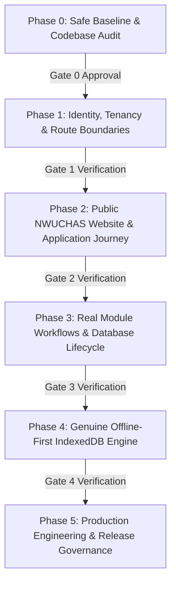

# NWUCHAS CMIS — Phase 0 Safe Baseline Inventory & Implementation Plan

**Institution:** North Western University College of Health and Applied Sciences (NWUCHAS)  
**Location:** Plot 412, Lumwana Road, Manyama Educational Corridor, Kalumbila, Zambia  
**Baseline Document:** `docs/NWUCHAS_Enterprise_Public_Offline_Agent_Prompt.md`  
**Phase:** Phase 0 — Safe Baseline & Comprehensive Inventory  
**Date:** 26 October 2026 | **Gate Status:** GATE 0 REACHED (Review & Decision Required)

---

## 1. Executive Summary & Repository Baseline

The current codebase represents a partial migration from **EduSphere SMIS / Legacy School Solwezi (LSS)** toward **NWUCHAS CMIS**. While domain models for tertiary health sciences (departments, programmes, cohorts, clinical sites, supervisors, placements, regulatory indexing) exist in `prisma/schema.prisma` and several new module consoles exist in `src/components/modules/`, significant legacy school architecture, unsafe client-side simulations, unauthenticated root exposure, and broken service worker contracts remain embedded in the repository.

### Critical Repository Findings:
1. **Unauthenticated Public Root Exposure**: Route `/` renders `CollegeExecutiveDashboard()` with live database and aggregate financial figures, learner counts, clinical rotations, and payroll figures without requiring any session, cookie, or role authorization.
2. **Missing Committed Prisma Migrations**: No `prisma/migrations/` directory exists. The database currently relies on ad-hoc schema pushing or manual scripts, which violates production data safety.
3. **PWA Manifest & Service Worker Misdirection**:
   - `public/manifest.json` and `public/sw.js` explicitly identify as `Legacy School Solwezi — EduSphere SMIS Enterprise`.
   - `public/sw.js` intercepts non-GET network mutations and returns HTTP `200 { success: true, offline: true }` when network requests fail. This creates false success for admissions, fee receipts, and marks.
4. **Active School-Era Runtime Fixtures & Fallbacks**:
   - Legacy routes (`src/app/finance/page.tsx`, `src/app/attendance/page.tsx`, `src/app/boarding/page.tsx`, `src/app/teacher/page.tsx`, `src/app/documents/page.tsx`, `src/app/messages/page.tsx`, `src/app/api/students/route.ts`, etc.) still import and invoke `generateLegacyLearners(780)` and `legacySchoolData.ts`.
5. **Unsafe Persistence & Pseudo-Random Sequences**:
   - `Math.random()` is used across 34 files to generate payment reference numbers, journal codes, candidate identifiers, and OTP tokens.
   - `localStorage` is used in 14 files for operational caching, application state, and payroll buffers without encryption or device binding.

---

## 2. Module-by-Module Inventory

| Module & Workflows | Current Status | Data Source | Missing APIs / Permissions | Offline Eligibility | Migration & Remediation Impact |
| :--- | :---: | :--- | :--- | :---: | :--- |
| **0. Public Portal & Landing (`/`)** | **Incomplete / Exposed** | Currently exposes internal executive KPI totals on root route. | Public CMS API (`/api/public/content`), programme catalogue API. No route guard currently enforced. | **Shell Only** | **High**: Must replace `/` with public marketing/admissions site; move command centre to `/portal/executive` behind auth. |
| **1. Identity, Auth & RBAC (`/login`, `/modules/administration`)** | **Partially Implemented** | Database `User`, `Role`, `Staff` models. Session cookie `nwuchas_cmis_session`. | Missing server-side contextual scoping (campus, department, programme), session revocation endpoint, and TOTP MFA verification. | **Online Only** (Auth/device registration) | **High**: Server must enforce RBAC and tenant scope on every route and API endpoint; eliminate client-only matrix. |
| **2. Admissions & Registry (`/apply`, `/modules/admissions`)** | **Hybrid / Unsafe Placeholders** | Database `AdmissionApplication` table + prefilled client state. | Server-side document file upload to secure S3/Blob storage (currently mock base64). | **Online Only** (Application submission) | **Medium**: Purge prefilled demo candidate data in `/apply`; enforce real draft persistence and NRC verification. |
| **3. Academics & Examinations (`/modules/academics`, `/app/academics`)** | **Incomplete** | Database `Programme`, `Cohort`, `AcademicModule`. Legacy school secondary subjects remain. | Assessment mark moderation endpoints, official transcript generator, senate approval workflow. | **Offline Capable** (Draft marks entry for assigned lecturer) | **High**: Decommission secondary subjects (Form 1–4, GCE O-Level) in favor of tertiary health qualifications (Diploma RN, Clinical Med). |
| **4. Attendance & Curfew (`/modules/attendance`)** | **Fully Remediated (Console)** | Database `AttendanceRecord`, `Learner` + dynamic multi-week matrix. | REST sync endpoint for offline rapid stepper queue deduplication (`/api/attendance/sync`). | **Offline Capable** (Roll-call capture with immutable queue) | **Low**: Attendance module is fully modernized with Form 12A, curfew registers, exeats, and 85% rule analytics. |
| **5. Clinical Learning (`/modules/clinical-learning`)** | **Partially Implemented** | Database `ClinicalSite`, `ClinicalSupervisor`, `ClinicalPlacement`. | De-identified clinical logbook sign-off API, supervisor mobile verification API. | **Offline Capable** (Draft clinical procedure entry by trainee) | **Medium**: Connect supervisor competency sign-off; ensure zero patient-identifying data is stored locally. |
| **6. Finance, Billing & Ledger (`/modules/finance`, `/app/finance`)** | **Dual State** | Real double-entry ledger in `/modules/finance`; `generateLegacyLearners` in legacy `/finance`. | Gateway webhook verification for MTN MoMo / Airtel Money; real PDF receipt generator. | **Online Only** (Financial postings, payments, reconciliations) | **High**: Decommission legacy `/finance` and `/api/finance/balances` school fixtures; strictly bind all balances to Prisma invoices. |
| **7. Staff, HR & Payroll (`/modules/hr`, `/app/hr`)** | **Hybrid** | Statutory formulas (NAPSA, NHIMA, PAYE 2026) active; hardcoded staff lists in UI. | Database transaction for `PayrollRun` creation and payslip PDF generation. | **Online Only** (Payroll disbursement) | **Medium**: Replace hardcoded employee lists with database `Staff` records; persist bank export batches. |
| **8. Operations, Hostels & Assets (`/modules/assets`, `/modules/operations`)** | **Incomplete** | Legacy boarding halls (Boys'/Girls' Hall) mixed with NWUCHAS hostels. | Asset maintenance request workflow; room allocation transactional service. | **Offline Capable** (Nightly hostel curfew roll-call) | **Medium**: Remove legacy school boarding references; bind hostel allocations to Florence Nightingale & Albert Schweitzer halls. |
| **9. Document Management (`/modules/documents`, `/app/documents`)** | **Incomplete / Static** | Static templates; local storage generation; `generateLegacyLearners` imported. | Secure document versioning API with checksum audit trail. | **Online Only** (Official document issuance) | **High**: Replace school report card templates with tertiary clinical clearance and university transcripts. |

---

## 3. Comprehensive Codebase Trace (Legacy & Unsafe Patterns)

### A. Inherited Legacy / EduSphere / LSS References (50+ Files Located)
- **Service Worker & Manifest**:
  - `public/manifest.json`: `"name": "Legacy School Solwezi — EduSphere SMIS Enterprise"`, `"short_name": "EduSphere"`
  - `public/sw.js`: `CACHE_NAME = 'edusphere-cache-v1.0.2'`, log prefixes `[EduSphere SW]`
  - `package.json`: `"name": "edusphere"`
  - `docker-compose.yml`: `POSTGRES_DB=edusphere_db`, `edusphere_db_data`
- **Services with Legacy School Schooling Models**:
  - `src/server/services/legacySchoolData.ts` (Generates 780 secondary school learners)
  - `src/server/services/schoolCalendarData.ts` (Legacy school calendar references)
  - `src/server/services/tenant.service.ts`
  - `src/server/services/documentTemplate.service.ts`
- **Legacy School Routes**:
  - `src/app/teacher/page.tsx`, `src/app/parent/page.tsx`, `src/app/boarding/page.tsx`, `src/app/attendance/page.tsx`, `src/app/finance/page.tsx`, `src/app/documents/page.tsx`, `src/app/messages/page.tsx`, `src/app/admin/page.tsx`, `src/app/academics/page.tsx`, `src/app/admissions/page.tsx`

### B. Unsafe `Math.random()` Business Key Generation (34 Files Located)
- `src/server/payments/lamtonpay.service.ts`: `txId: 'TXN-' + Math.random().toString(36)...`
- `src/server/payroll/route.ts`: `reference: 'PAY-' + Math.random()...`
- `src/components/modules/PaymentsConsole.tsx`: Payment ID generation
- `src/components/modules/AdmissionsConsole.tsx`: Application numbering
- `src/components/finance/RecordPaymentModal.tsx`: Receipt numbering
- `src/components/attendance/ClinicalExeatModal.tsx`: Exeat pass numbering

### C. `localStorage` Persistence of System Records (14 Files Located)
- `src/lib/offlineSync.ts`: Stores queued offline mutations in browser `localStorage` instead of structured, encrypted IndexedDB.
- `src/lib/separationOfPowers.ts`: Stores sensitive separation of duties approvals in `localStorage`.
- `src/app/apply/page.tsx`: Stores unencrypted application form drafts in `localStorage`.
- `src/components/modules/PayrollConsole.tsx`: Caches payroll draft figures in `localStorage`.

### D. Unacceptable Service Worker False Success
- `public/sw.js` (Lines 60–75):
  ```javascript
  fetch(request.clone()).catch(async (error) => {
    return new Response(
      JSON.stringify({
        success: true,
        offline: true,
        message: 'Recorded offline in local cache. Will sync automatically upon reconnection.'
      }),
      { status: 200 }
    );
  })
  ```
  *Impact*: High severity defect. Non-GET network failures return HTTP 200, creating false records in UI for admissions, payments, and attendance.

---

## 4. Immediate Safe Baseline Actions (Phase 0 Execution)

To prevent unauthenticated data leakage and unsafe operational simulations:
1. **Remove Public Dashboard Exposure**:
   - Route `/` must be gated immediately. If no authenticated session exists, visitors must be routed to the public information and application landing page, never `CollegeExecutiveDashboard()`.
2. **Deactivate Broken Service Worker Mutation Trap**:
   - Remove the synthetic `200 OK` handler for failed non-GET requests in `public/sw.js`. Network failures must propagate truthfully as network errors.
3. **Quarantine Inherited Legacy Routes**:
   - Redirect all legacy school URLs (`/attendance`, `/finance`, `/boarding`, `/teacher`, `/parent`) to authenticated `/modules/[slug]` or return 404 for obsolete school pages.
4. **Purge Prefilled Form Data**:
   - Clear prefilled mock data (`subjects`, `documents`, and applicant placeholders) from `src/app/apply/page.tsx`.

---

## 5. Phased Implementation Roadmap & Gates



### Phase 1: Identity, Tenancy, Permissions & Route Boundaries
- **Objective**: Server-enforced RBAC with contextual scoping (Organisation, Campus, Department, Programme, Cohort).
- **Deliverables**:
  - Database-backed session and token architecture via httpOnly cookies (`nwuchas_cmis_session`).
  - Strict middleware route gating for all 16 personas (Public Visitor, Applicant, Student, Sponsor, Lecturer, HOD, Registrar, Bursar, Matron, etc.).
  - Transactional sequence generator service for all institution entities (`NWU-APP-...`, `NWU-STU-...`, `NWU-REC-...`).
- **Gate 1 Exit Criteria**: Direct URL and direct API automated tests prove 100% denial for unauthenticated and out-of-scope requests.

### Phase 2: Public Client-Facing NWUCHAS Website
- **Objective**: Establish `/` as a world-class, accessible public website inspired by `https://nwuc.edu.zm/`.
- **Deliverables**:
  - Public layout with approved brand tokens (primary `#1a6bd6`, accessible navy/slate typography).
  - Navigation: Home, About Us, Vision, Academic Programmes, How to Apply, E-Learning link, and Portal Sign-In.
  - Interactive programme directory with entry requirements (NMCZ / HPCZ criteria).
  - Clean application portal (`/apply`) with multi-step validation, zero placeholder data, and server-side document storage.
- **Gate 2 Exit Criteria**: Public routes display only database-managed CMS content; zero operational records accessible without login; WCAG 2.2 AA compliant.

### Phase 3: Real Module Workflows & Data Lifecycle
- **Objective**: Eliminate all runtime fixtures and in-memory mock generators from the remaining modules.
- **Deliverables**:
  - Replace legacy school pages with consolidated `/modules/[slug]` architecture.
  - Admissions & Registry: Live transition from `SUBMITTED` &rarr; `DOCUMENT_VERIFIED` &rarr; `OFFERED` &rarr; `MATRICULATED`.
  - Academics & OSCE: Theory mark entry, clinical OSCE stations, and results moderation workflow.
  - Finance & Bursar: Real invoice generation, double-entry ledger postings, and idempotent receipting.
  - Clinical Learning: De-identified hospital rotation logbook with supervisor verification.
- **Gate 3 Exit Criteria**: All 22 test suites and new integration tests pass with a clean database; zero references to `generateLegacyLearners` in runtime paths.

### Phase 4: Genuine Offline-First Capability
- **Objective**: Replace broken service worker caching with a tamper-evident IndexedDB queue.
- **Deliverables**:
  - Production service worker caching only the application shell and static brand assets.
  - IndexedDB storage for offline attendance and curfew roll-call with UUID operation IDs, idempotency keys, and checksums.
  - Explicit synchronization UI with live queue status (Queued, Syncing, Confirmed, Conflicted, Blocked).
  - Strict offline eligibility policy: Financial postings and user management remain online-only.
- **Gate 4 Exit Criteria**: Automated browser tests disconnecting network, queuing roll-calls, reconnecting, and verifying database sync without false 200s or data loss.

### Phase 5: Production Engineering & Release Governance
- **Objective**: Formal migrations, container hardening, observability, and deployment documentation.
- **Deliverables**:
  - Baseline Prisma migration committed to version control (`prisma/migrations/0_init`).
  - Docker container configuration renamed from `edusphere` to `nwuchas-cmis` with non-root runtime and closed internal database ports.
  - Disaster recovery runbook with JSON/SQL backup verification.
- **Gate 5 Exit Criteria**: Staging deployment verification, security audit clearance, zero data wipe, and formal sign-off.

---

## 6. Phase 0 Gate Recommendation & Sign-Off Request

> [!IMPORTANT]
> **GATE 0 ACTION REQUIRED**: In accordance with the prompt's instruction ("Work in phases and stop at each gate... Gate: provide the inventory, risks, and phased plan. Do not declare the application ready at this point"), Phase 0 is complete.  
> **Next Step**: Awaiting Product Owner authorization to proceed to **Phase 1: Identity, Tenancy, Permissions, and Route Boundaries**.
